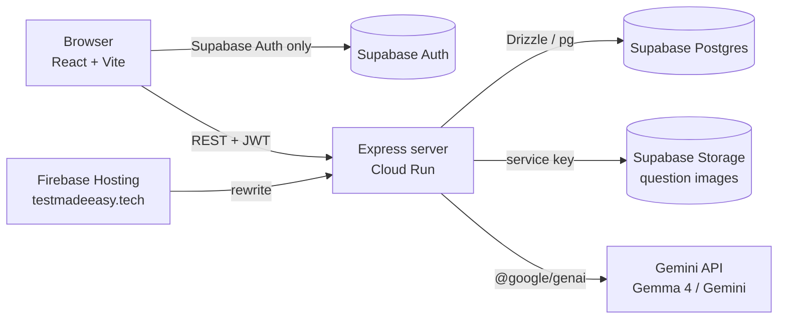

<div align="center">
  
  <h1>TestMadeEasy</h1>
  <p><strong>Photo of a textbook page in. Print-ready, branded test paper out.</strong></p>
  <p>
    <a href="https://testmadeeasy.tech">testmadeeasy.tech</a> ·
    <a href="docs/FEATURES.md">Features</a> ·
    <a href="docs/USER_GUIDE.md">User guide</a>
  </p>
</div>

---

TestMadeEasy is a question-paper builder for coaching teachers. You photograph a page from a reference book, and the open-weight **Gemma 4** model pulls every question off it as clean LaTeX: options, subject, chapter, topic, difficulty, marks, and where any diagram sits. The questions land in your own question bank. You pick the ones you want, add your institute's logo, colour and watermark, and print a test paper plus its answer key.

It's built for the small coaching institutes in India that run weekly JEE, NEET and board-exam tests and currently retype every question by hand.

## What it does

- **Photo to LaTeX.** Upload up to 20 page photos at once. Each page is split into separate questions, MCQ options are kept apart from the stem, and maths comes out as real LaTeX (`$\frac{1}{2}mv^{2}$`, not "1/2 mv2").
- **Diagrams.** The model flags which questions have a diagram and returns its bounding box, so the app crops it from the original scan. It can also redraw simple diagrams as TikZ, rendered in the browser.
- **Answers.** Generate answers in 3 lengths: option only, one-line reason, or a full worked solution.
- **Question bank.** Filter your library by subject, chapter, topic and difficulty. A shared master bank de-duplicates questions across teachers, and admins review edits before they reach it. Admins can also bulk-import whole PDFs into the master bank.
- **Branding.** Logo, accent colour, header layout, contact line and watermark on every paper.
- **Papers and answer keys.** Pick questions, set marks and negative marking, and print the paper and its answer key from the browser.
- **Background jobs.** Extraction runs as a job, so you can upload a stack of pages and keep working.

## Open models at the core

Every AI task runs on **Gemma 4** by default, served through the Gemini API with a normal Gemini API key:

| Task | Default model |
|---|---|
| Question extraction from photos and PDFs | `gemma-4-31b-it` |
| Answer generation | `gemma-4-31b-it` |
| TikZ diagram redraw | `gemma-4-31b-it` |
| Scoring edits to shared master questions | `gemma-4-26b-a4b-it` (MoE, 4B active) |

Gemma 4 on the Gemini API accepts the same system instructions and JSON response schemas as Gemini, so the extraction prompt and schema are identical for both. Admins can switch any task to a Gemini model from **Admin → Model Configuration**; the choice is stored in the database and nothing else in the code changes.

Why Gemma: it's free on the Gemini API, which keeps the per-page cost near zero for a price-sensitive market, and the weights are open, so the same model can be self-hosted later for schools that don't want exam papers leaving their own machines.

## Architecture



- The browser only uses Supabase for sign-in. All data reads and writes go through the Express API, which verifies the Supabase JWT and talks to Postgres as the `postgres` role.
- Row Level Security is on for every table, so the public anon key can't read or write app data directly. See [`supabase/migrations`](supabase/migrations).
- Long AI work (extraction, answers, review scoring) runs in background jobs stored in the `jobs` table; the client polls `/api/jobs`.

## Tech stack

| Layer | Tools |
|---|---|
| Frontend | React 18, Vite, Tailwind CSS, Radix UI / shadcn, TanStack Query, wouter, MathJax, TikZJax, pdf.js |
| Backend | Node 20, Express 5, Drizzle ORM, multer, sharp, p-limit / p-retry |
| AI | `@google/genai` SDK → Gemma 4 (default) or Gemini |
| Data | Supabase Postgres, Auth (email + Google) and Storage |
| Hosting | Google Cloud Run (container) behind Firebase Hosting |

## Run it locally

You need Node 20+, a Supabase project and a Gemini API key ([get one here](https://aistudio.google.com/apikey)).

```bash
git clone https://github.com/amrit-dash/testmadeeasy.git
cd testmadeeasy
npm install
cp .env.example .env   # then fill in the values
```

| Variable | Where to find it |
|---|---|
| `DATABASE_URL` | Supabase → **Connect** → **Session pooler** URI (port 5432) |
| `VITE_SUPABASE_URL` | Supabase → Project Settings → Data API |
| `VITE_SUPABASE_ANON_KEY` | Supabase → Project Settings → API Keys (`anon`) |
| `SUPABASE_SERVICE_ROLE_KEY` | Same page (`service_role`). Server only, never ship it to the browser |
| `GEMINI_API_KEY` | Google AI Studio |

Create the tables and security rules:

```bash
npx drizzle-kit push    # tables from shared/schema.ts
```

Then run each file in [`supabase/migrations/`](supabase/migrations) in the Supabase SQL editor, oldest first.

Start the dev server (API and Vite on one port):

```bash
npm run dev    # http://localhost:5000
```

Sign up, then make yourself admin so you can see the admin pages:

```sql
update public.users set role = 'admin' where email = 'you@example.com';
```

### Google sign-in (optional)

In Supabase → Authentication → Sign In / Providers → Google, paste a Google OAuth client ID and secret. In Google Cloud, add `https://<project-ref>.supabase.co/auth/v1/callback` to the client's authorized redirect URIs, and set your site URL and redirect URLs under Authentication → URL Configuration.

## Deploy

The repo ships a production `Dockerfile` (multi-stage, runs as a non-root user on port 8080).

```bash
gcloud run deploy testmadeeasy --source . --region asia-south1
```

Set the same variables from the table above on the Cloud Run service; keep `DATABASE_URL`, `SUPABASE_SERVICE_ROLE_KEY` and `GEMINI_API_KEY` in Secret Manager. The server injects `VITE_SUPABASE_URL` and `VITE_SUPABASE_ANON_KEY` into the page at runtime, so changing them doesn't need a rebuild.

### Keeping a free Supabase project awake

Free Supabase projects pause after 7 days without database activity. [`.github/workflows/supabase-keep-alive.yml`](.github/workflows/supabase-keep-alive.yml) runs one tiny REST query every day. Add `SUPABASE_URL` and `SUPABASE_ANON_KEY` as repository secrets to turn it on. It also pushes a heartbeat commit if the repo goes quiet for 3 weeks, because GitHub disables scheduled workflows after 60 days without commits.

## Project structure

```
client/               React app (pages/, components/, hooks/, lib/)
server/               Express API
  routes.ts           API routes, extraction prompts and schemas
  storage.ts          Drizzle data access
  auth.ts             Supabase JWT verification and user sync
  jobs.ts             Background job tracking
  ai-pricing.ts       Per-model pricing and output-token caps
  system-settings.ts  Active model per task (stored in DB)
shared/schema.ts      Drizzle schema shared by client and server
scripts/              Maintenance scripts (pricing refresh, master-bank sync)
supabase/migrations/  RLS and security SQL
docs/                 Feature list and user guide
```

## Scripts

| Command | What it does |
|---|---|
| `npm run dev` | API + Vite dev server with hot reload |
| `npm run build` | Builds the client and bundles the server into `dist/` |
| `npm start` | Runs the production bundle |
| `npm run check` | TypeScript type check |

## Team

Built by **Amrit Dash** and **Akash Agarwal**.

## License

[MIT](LICENSE)
